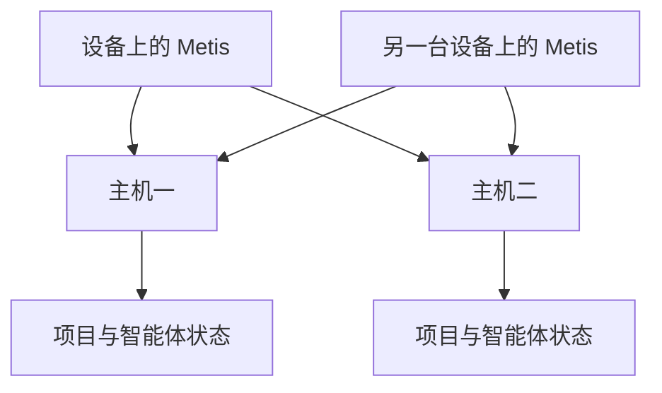

# Metis 架构

Metis 是面向个人开发者的多主机智能体工作台。用户可以从一台设备操作多台主机上的智能体，并在另一台设备上继续会话、查看任务和处理审批。编辑器用于修改代码和审查智能体的改动。

## 一个应用，两种构建

用户只安装和启动 Metis。主机服务、智能体运行时和连接管理由应用自动完成，没有需要分别启动或管理的组件。

同一代码库提供两种发布构建：

- **Metis Server** 只包含主机服务和 Harness 运行所需组件，面向无显示服务器，不引入图形界面、编辑器、Tree-sitter 或桌面系统库。
- **Metis 工作台** 包含完整的 Metis Server 能力，并提供图形界面、代码编辑和差异审查。

两种构建共享主机服务实现与客户端协议。图形界面关闭后，智能体仍在项目所在的主机上工作；再次打开 Metis 即可接入原会话。

## 主机与设备

项目文件和智能体状态保存在各自的主机。跨设备继续工作，实际上是另一台设备重新接入原主机，而不是把运行中的会话迁移或复制到别处。

编辑器随工作台提供。未保存的文本保留在当前设备，智能体的会话、任务和审批则由主机持续保存。

## 主机运行时

每台参与工作的主机运行一个常驻 Metis Server 进程，由它启动和管理一个 DeepSeek Harness 进程，并处理项目资源。Metis 核心使用 Rust，Harness 使用 Node.js，所选发布构建携带对应的运行组件并统一管理。

客户端断开后，主机服务继续管理智能体。Harness 重启后的历史恢复与运行状态恢复范围，见[集成调研](research/deepseek-harness.md)。

## 网络功能

多主机发现、设备注册、连接中继和偏好同步属于 Metis 的网络能力，可以由独立的网络服务承担。它们融入连接流程，不构成用户需要单独理解的另一款产品。

本地使用与远程使用共用相同的主机会话模型；本地机器只是其中一台主机。

## 编辑器

编辑器服务于智能体工作流程，覆盖代码查看、文件修改和差异审查。界面技术、文本模型和写入协调属于实现细节，由相应模块和代码说明。

产品交付顺序见[产品范围与里程碑](product-scope.md)。
