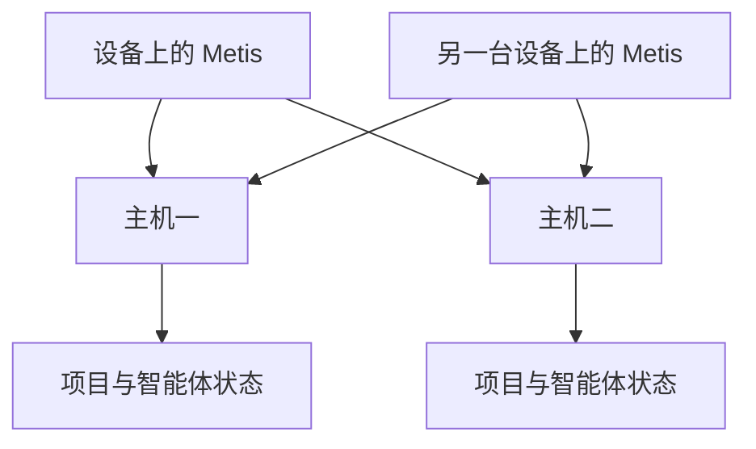

# Metis 架构

Metis 是面向个人开发者的多主机智能体工作台。用户可以从一台设备操作多台主机上的智能体，并在另一台设备上继续会话、查看任务和处理审批。编辑器用于修改代码和审查智能体的改动。

## 一个应用，两种发布包

主机以系统 Git 为前置条件，其余运行组件随 Metis 提供。智能体运行时和连接管理由应用自动完成，没有需要分别启动或管理的组件。

同一代码库提供两种发布包：

- **Metis 无显示运行包**包含 Node.js、DeepSeek Harness（dsh）和 Metis 扩展，面向无显示主机，不引入图形界面、编辑器、Tree-sitter 或桌面系统库。
- **Metis 工作台**包含相同的扩展 dsh 运行时，并提供图形界面、代码编辑和差异审查。

工作台直接连接扩展后的 dsh，使用 Harness 与 Metis 扩展提供的主机能力。

## 主机与设备

项目文件和智能体状态保存在各自的主机。跨设备继续工作，实际上是另一台设备重新接入原主机，而不是把运行中的会话迁移或复制到别处。

编辑器随工作台提供。未保存的文本保留在当前设备，智能体的会话、任务和审批则由主机持续保存。

## 主机运行时

扩展 dsh 直接承担主机服务。Harness 负责智能体会话、任务、审批、事件和历史；Metis 扩展负责项目文件、Git 操作以及主机、项目与会话之间的映射。工作台使用 Rust，Metis 扩展运行在 Node.js 中，Metis 统一管理这些组件的版本与启动。

本地工作台自动启动仅供当前界面接入的扩展 dsh。工作台正常关闭或异常退出时，该运行时及本地智能体随之停止；再次打开工作台会创建新的运行时。

用于持续运行或跨设备接入的主机运行常驻扩展 dsh，客户端断开不影响其管理的智能体。Harness 重启后的历史恢复与运行状态恢复范围，见[集成调研](research/deepseek-harness.md)。

## 网络功能

多主机发现、设备注册、连接中继和偏好同步属于 Metis 的网络能力，可以由独立的网络服务承担。它们融入连接流程，不构成用户需要单独理解的另一款产品。

主机接口需要客户端认证，项目文件与 Git 操作限定在已打开的项目中。

本地使用与远程使用共用相同的主机会话模型；本地机器只是其中一台主机。

## 编辑器

编辑器服务于智能体工作流程，覆盖代码查看、文件修改和差异审查。界面技术、文本模型和写入协调属于实现细节，由相应模块和代码说明。

产品交付顺序见[产品范围与里程碑](product-scope.md)。
